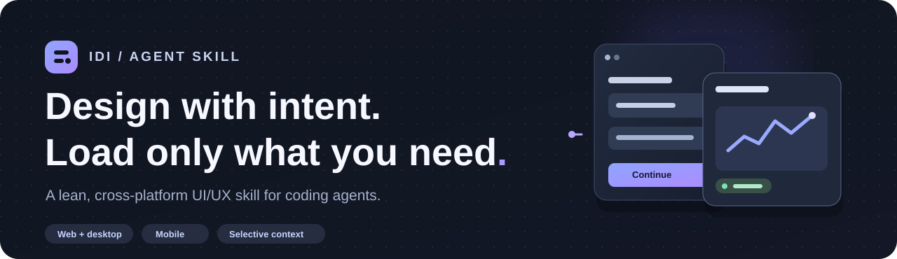
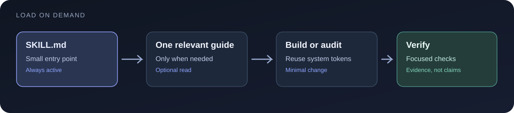
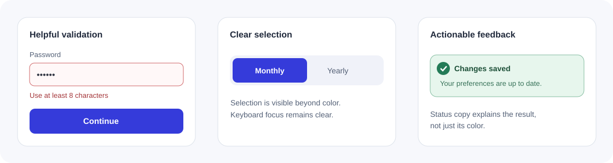

<p align="center">
  
</p>

<h1 align="center">Interface Design Intelligence</h1>
<p align="center">
  <strong>A focused UI/UX skill for coding agents.</strong><br>
  Design, refine and audit interfaces across web, desktop and mobile—without loading an entire design handbook for every task.
</p>

<p align="center">
  <a href="https://github.com/itslinkdev/interface-design-intelligence/actions/workflows/checks.yml"></a>
  <a href="LICENSE"></a>
  
</p>

---

## The idea

Most interface work doesn't need a full redesign. A confusing dropdown, a sluggish animation or an inaccessible dark theme needs **the right rule at the right time**, not a hundred design prescriptions.

Interface Design Intelligence gives an agent a small operating contract, then lets it consult focused guidance only when the task warrants it.

<p align="center"></p>

| Inspect first | Design deliberately | Verify the result |
| :-- | :-- | :-- |
| Understand the product, constraints and existing components. | Pick a task-specific reference; preserve the established identity unless a redesign is requested. | Check behavior, accessibility, responsiveness, themes and motion—without inventing test results. |

## Install

**GitHub CLI 2.90.0+** supports installing Agent Skills directly from GitHub (preview):

```bash
gh skill install itslinkdev/interface-design-intelligence interface-design-intelligence --agent codex --scope user
```

To install for another supported agent, change `--agent` (for example `claude-code` or `github-copilot`). See [`gh skill install`](https://cli.github.com/manual/gh_skill_install).

Alternatively, copy the complete repository folder into a skills directory your agent recognizes. For a project following the `.agents/skills/` convention:

```bash
mkdir -p .agents/skills
git clone https://github.com/itslinkdev/interface-design-intelligence.git .agents/skills/interface-design-intelligence
```

> **Keep the folder intact.** `SKILL.md` points to optional guides, scripts and style recipes. GitHub CLI installation requires the repository to be public and available; until then, use the [local package](PUBLISHING.md).

## What it helps with

| Area | Focus |
| :-- | :-- |
| **UX & interface structure** | Navigation, forms, error states, feedback, hierarchy, usability patterns |
| **Design systems** | Typography, color, spacing, tokens, responsive composition |
| **Dark mode** | Tonal surfaces, contrast, depth, accent colors and theme choice |
| **Interaction & motion** | Slider behavior, easing, reduced motion, smooth rendering |
| **Implementation** | Web, Windows, cross-platform desktop and mobile conventions |
| **Audit & refinement** | Evidence-based findings, accessible controls and focused fixes |

The skill supports three working modes: **PLAN** (decisions and acceptance criteria), **BUILD** (implement and verify), and **AUDIT** (report findings without editing unless requested).

### Five optional visual directions

<p align="center"></p>

| Direction | Where it fits | Guardrail |
| :-- | :-- | :-- |
| [Liquid Glass](styles/liquid-glass.md) | Floating controls, layered toolbars | Contrast and transparent-material fallback |
| [Analog Grain](styles/analog-grain.md) | Tactile backgrounds, editorial hero sections | Keep texture away from body text |
| [Chrome Typography](styles/chrome-typography.md) | Display headings and branding moments | Readable, static fallback |
| [Pixel Accents](styles/pixel-accents.md) | Small graphic details, creative UI | Never obscure genuine controls |
| [Editorial Serifs](styles/editorial-serifs.md) | Premium layouts and large headlines | Usable sans-serif interface text |

These are **recipes, not defaults**. The agent selects one only when a visual direction is relevant. The [offline gallery](examples/style-gallery.html) contains original examples; it has no third-party fonts or screenshots.

## Try it

```text
Use Interface Design Intelligence to audit my settings screen.
Identify accessibility and hierarchy issues; do not edit code yet.
```

```text
Refine this Windows desktop application's dropdowns and account page.
Preserve behavior and native keyboard interactions, match the existing
visual identity, and verify animations on low-power hardware.
```

```text
Build a responsive landing page with editorial typography and restrained
analog grain. Explain the design choices and check mobile readability.
```

### Find only the guidance you need

```bash
python scripts/find_pattern.py "searchable dropdown" --limit 2
python scripts/find_style.py "subtle glass navigation" --limit 2
python scripts/check_contrast.py '#BFC0CA' '#19191D'
```

Python's standard library is sufficient for the optional utilities; **Python is not required to read or apply the skill**.

<p align="center"></p>

## Built to respect context

`SKILL.md` is the only mandatory entry point. References, framework notes, style recipes, the searchable 62-pattern catalog and offline demos are all **opt-in**.

| Source | Footprint | Loaded automatically? |
| :-- | --: | :-- |
| Core `SKILL.md` | **3,462 bytes** (~858 char/4 proxy) | When skill is activated |
| 16 focused UX/UI guides | 32,132 bytes combined | No |
| 9 platform adapters | 5,848 bytes combined | No |
| 62 pattern entries | 8,322 bytes combined | No |
| 5 style recipes + selection guide | 11,713 bytes combined | No |

The proxy is **not actual token usage** and there are **no controlled head-to-head quality claims** against other skills. Full measurement methodology and a reproducible comparison template live in [`docs/benchmarks.md`](docs/benchmarks.md).

## Platform coverage

**Web:** React, Vue, Tailwind · **Windows:** WinUI / WPF · **Desktop:** Electron / Tauri, Qt / PySide · **Mobile:** Flutter, SwiftUI, Jetpack Compose.

Framework notes are small reminders about common pitfalls, not replacements for official platform documentation.

## Project structure

```text
SKILL.md                 # small entry point + task routing
references/              # 16 optional guidance modules
styles/                  # 5 aesthetic recipes
stacks/                  # 9 platform adapters
assets/                  # original SVGs + searchable indexes
scripts/                 # search, checks and token utilities
examples/                # original offline UI demonstrations
tests/                   # validations and regression tests
```

**Local QA** (Python 3.11+):

```bash
python scripts/validate_skill.py
python -m unittest discover -s tests -p 'test_*.py' -v
python scripts/audit_public.py
python scripts/measure_footprint.py
```

View the [slider motion demo](examples/slider-motion-demo.html) or [dark mode demo](examples/dark-ui-demo.html) locally in a browser. The skill honors keyboard interactions, accessible labels and reduced-motion preferences.

## Contributors

<table>
  <tr>
    <td width="50%">
      <strong><a href="https://github.com/itslinkdev">@itslinkdev</a></strong><br>
      Creator · maintainer · project direction and releases
    </td>
    <td width="50%">
      <strong>ChatGPT (OpenAI)</strong><br>
      AI collaborator · design synthesis, documentation, implementation support and QA
    </td>
  </tr>
</table>

Built collaboratively under the maintainer's direction. **ChatGPT is acknowledged as an AI collaborator, not a GitHub account or an official OpenAI-sponsored project.** The GitHub Contributors graph records GitHub commit authors separately. See [credits](ACKNOWLEDGMENTS.md).

## Contribute and license

Issues and pull requests are welcome, particularly for accessibility, cross-platform behavior, performance and reproducible evaluations. Keep new guidance focused and the always-loaded core short. Read [Contributing](CONTRIBUTING.md), [Security](SECURITY.md), and [Changelog](CHANGELOG.md).

Original text, code and illustrations are published under the [MIT license](LICENSE). Third-party social-media screenshots, videos and licensed fonts are not redistributed.
